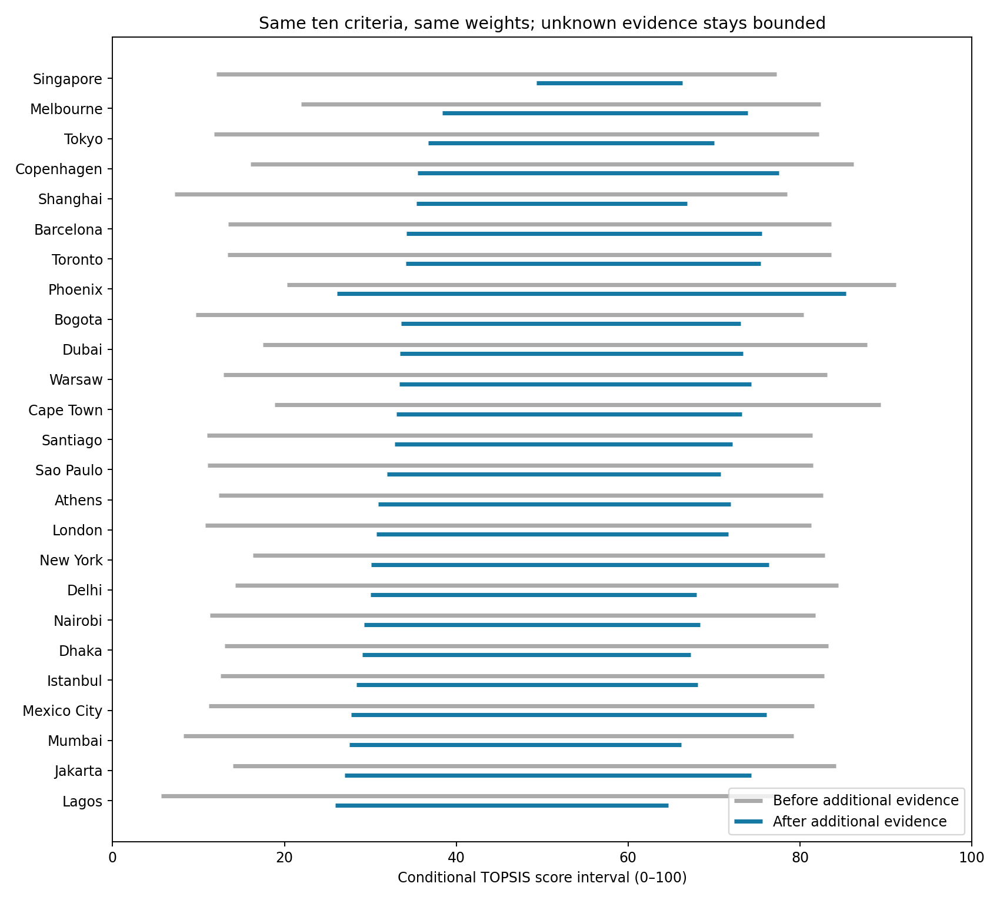

# 新版10指标：证据区间决策模型 V5

## 人话解释与本轮结论

模型回答：这25座候选城市中，在我们掌握的高中生生活证据下，哪些城市仍可能最好？如果必须先选一座，哪一座在最不利的缺失数据补全下损失最小？它不是预测高考成绩，也不是把信息缺失当城市差。

采用用户新版指标的8主2辅结构，修正错误口径后实现。原附件原样保存在 `../../inputs/team/task4_v5/`，修订规范在 `../../design/task4_v5_indicator_spec.md`，程序在 `../../scripts/task4_v5_model.py`。这里只改研究模型，未改论文主稿。

**实际结果：证据明显收紧，但尚未识别唯一冠军。** 同模型补数前后，可能冠军仍25→25，每城可能名次仍1–25。稳健决策排序发生变化，第一从Phoenix变为Singapore；这不是宣称Singapore已被证明为城市表现冠军。

| 检验量 | 补数前 | 补数后 |
|---|---:|---:|
| 有信息的城市×指标单元 /250 | 28 | 104 |
| 平均TOPSIS得分区间宽度 /100 | 69.7309 | 39.8359 |
| 最小的最坏决策损失 /100 | 69.0876 | 35.9604 |
| 可能冠军数 | 25 | 25 |
| 必然冠军数 | 0 | 0 |
| 最坏损失最小的选择 | Phoenix | Singapore |

区间宽度减少42.87%，最坏决策损失减少47.95%。这证明的是**在所采用来源与口径条件下，补充证据减少了决策不确定性**，不证明预测准确率提高，也不证明算法优于所有其他方法。99个单元作为条件点值，另外5个为3城通学区间和2项资源下界；其余146格完全未知。点值不代表测量无误，只表示本轮未另设可校准的测量误差区间。

## 新数据、旧证据和错误修正

- 25城2025生活成本来自此前已归档Numbeo表的新提取；25城PIR保持原值。不是新采集的2026调查。生活成本不含房租，PIR不是租金收入比，也不只计算市中心房价。
- 22城PM2.5来自WHO 2026发布版本，但实际观测年份不一。Phoenix/New York都市圈记录不当市级值；Mexico City缺统一城市值。WHO不建议不加限定地据此作跨城排名，因此主结果标“条件分析”，另做删除空气指标证据及年份/覆盖筛选。
- 23城固定宽带统一Ookla 2026年9月中位数（滚动季度），新加坡476.02 Mbps；附件667.71是均值。Phoenix缺失，South Jakarta不能替代Jakarta。
- 东京高中生师比15.6487、上海普通高中9.8821、新加坡匹配Pre-U子群12.3204，均为2024人数口径。替换初中样例，保留范围差异。师生比是资源代理，不是学生成绩或因果教育质量；本轮没有补出25城统一高中学习成果数据。
- 新加坡2023故意凶杀率0.0690955/10万人来自WDI；城市国家可对齐地理范围，其他城市不填全国值。
- 新加坡政府验证6所自主大学，只确认高教名录下界；ROR的120条education记录包括中学，不能都算大学。
- 新加坡5205个独立公交停靠点代码，密度83.8367/10万人；只有公交模式且运营状态未逐站确认，按条件名录下界处理，不冒称50米聚类站址或高中生可达率。
- 泳池目录25处并不足以确认全年可用完整总量；暂保留25城泳池未知，不为了凑齐指标硬填。

真实学生通学原证据全部保留：纽约2013–14九年级报告均值产生Jensen界；新加坡2020人口普查学生分组、未知学段混合权重产生上下界；Melbourne VISTA 2024–25的15–19岁中学学生实际行程产生效用。本轮Melbourne用既有家庭bootstrap的[0.50391,0.60158]探索区间，两臂均使用，**不是设计型95%置信区间**。其他22城通学保持[0,1]。本轮没有新获得第四城真正高中生通学数据；公交站数量和汽车10公里时间不替代它。

每条新观测的链接、年份、范围、状态及效用端点在 `source_admission.csv`；原始响应和提取器在四个 `../../data/task4_v5_*/` 目录。来源完整性由SHA256审计。来源跨年且边界并非全统一，不能把本次结果称为同年行政城市普查排名。

## 数学公式与创新实际落点

设城市i、指标j原始值为x，固定正锚点a。成本型效用为 a/(a+x)，收益型为 x/(a+x)。锚点是明确的规范选择，不从本批城市极值反推，避免加入城市后所有既有城市归一化值都改变。默认锚点依序为2、15、100、10、15、1、50、通学原效用、100、1。

通学效用为 T=E[exp(-t/30)]，t单位分钟；统计群体和不完整分布决定其界。8项主指标各0.1125，公交和泳池各0.05，各城同权重且不因缺数重新归一。缺失效用为[0,1]；部分资源名录仅给收益下界[u(x),1]。

$$D_i^+=\sqrt{\sum_jw_j(1-u_{ij})^2},\quad D_i^-=\sqrt{\sum_jw_ju_{ij}^2},\quad S_i=100\frac{D_i^-}{D_i^++D_i^-}.$$

该得分对每项效用单调，因此城市的条件得分界直接是 L_i=S(l_i), U_i=S(h_i)，无需先给缺数强加概率分布。这里假设各未知格的允许取值构成矩形集合；未建模指标相关约束，故现实可行集可能更小，报告集合是保守外包。收益锚定1可能只是极限，闭区间仍是保守闭包。

$$r_i^{best}=1+\sum_{k\ne i}1(L_k>U_i),\quad r_i^{worst}=1+\sum_{k\ne i}1(U_k>L_i).$$

可能冠军集合为 {i: U_i≥max_{k≠i}L_k}。最坏遗憾 R_i=max(0,max_{k≠i}U_k−L_i)，稳健选择为argmin R_i。`decision_rank`按R排序，是采取“选该城”这一行动的排序，不是已识别的真实城市名次。

本轮实质贡献是可运行的组合：**真实学生证据约束 + 部分资源单侧界 + 固定指标缺失传播 + 最坏遗憾决策 + 无先验补数价值**。它解决了不完整名单被当完整总量、缺数城市被重权重、模拟冠军概率取决于随意填值分布的问题。不宣称这些数学工具本身原创；论文创新应定位到问题、证据表示与可审计决策流程的结合，不能保证获奖。

未在稀疏矩阵上强行PCA；否则必须先填出大量不存在的数据。未把蒙特卡洛频率称真实冠军概率。Kendall τ用于比较同一默认规则补数前后的决策排序，本轮τ=0.20667，表明信息更新改变了行动排序，但低相关本身不是改进指标。

## 排名变化与稳健性

| 城市 | 补数前决策序 | 补数后决策序 |
|---|---:|---:|
| Singapore | 15 | 1 |
| Melbourne | 2 | 2 |
| Tokyo | 16 | 3 |
| Copenhagen | 6 | 4 |
| Shanghai | 24 | 5 |
| Phoenix | 1 | 8 |
| New York | 5 | 17 |
| Jakarta | 8 | 24 |

完整25城表见 `rank_changes.csv`。Singapore证据比多数城市完整，是其最坏损失较小的重要原因；这不是对数据丰富城市更优的因果证明。各城可能冠军资格均未排除，全部城市真实名次界仍1–25。

执行3档锚点尺度×3档辅助权重×6种证据筛选，共54组。包括去除全部WHO、仅保留≥2023且覆盖≥75%的WHO（75%是研究敏感性阈值不是WHO规则）、去除PTR、同时去除WHO/PTR/两类资源下界、去除凶杀率证据。54组稳健选择均Singapore，可能冠军均25；这只是所测范围内稳健，未覆盖任意权重和所有数据误差。“strict_scope”只是排除指定条件证据，其他来源和真实通学的条件性仍在。



## 下一步应该补什么

`acquisition_priority.csv`计算每一个未确定单元被精确测量后的最坏损失改善范围：对观测x，重新求minimax，再对可能x求最坏与最好结果，单调结构用二分定位交点。未给未知x设置概率，因此不是期望信息价值。

当前**所有单格补数的保证收益均0**；不能承诺随便补一格必然改善选择。Phoenix多个主指标的最好情形收益可达7.7868分，原因是它当前得分上界85.3163限制了稳健损失。它们并列，不表示各数据项采集成本或现实分布相同。优先考虑Phoenix的真正高中生通学、同口径高中资源和市级凶杀，联合补数比宣称某一格必胜更合理；成本未知时不能将此表解释成采集成本最优计划。

后续真正缩小冠军集合，需要扩展高中生通学和完整城市资源证据，或有证据支撑的跨指标可行性约束。不能把缺失区间人为缩窄来制造获胜城市。

## 复现与验证

在仓库根目录运行：

```sh
python3 research/2026-a/data/task4_v5_core/extract_core.py
python3 research/2026-a/data/task4_v5_air/extract_air.py
python3 research/2026-a/data/task4_v5_education/extract_education.py
python3 research/2026-a/data/task4_v5_resources/extract_resources.py
python3 research/2026-a/scripts/task4_v5_model.py
python3 research/2026-a/scripts/test_task4_v5.py
python3 research/2026-a/scripts/task4_interval_decision.py
```

检验包括前后证据集嵌套、三城真实通学不变、固定权重、泳池保持未知、部分名录上界1、1024个效用角点与解析得分界一致、撤回证据使区间扩张，以及既有冠军/名次角点枚举和非线性信息价值网格核验。原附件按字节复制并记录SHA256。独立代码复核见 `../task4_v5_review.md`。

补数前后都使用V5的同一10项构念；补数前仅PIR25格和真实通学3格。这个受控对照用于隔离V5内的信息增量，**不是旧V4模型原排名**；不得把V4到V5的构念变化归因成纯数据改进。
