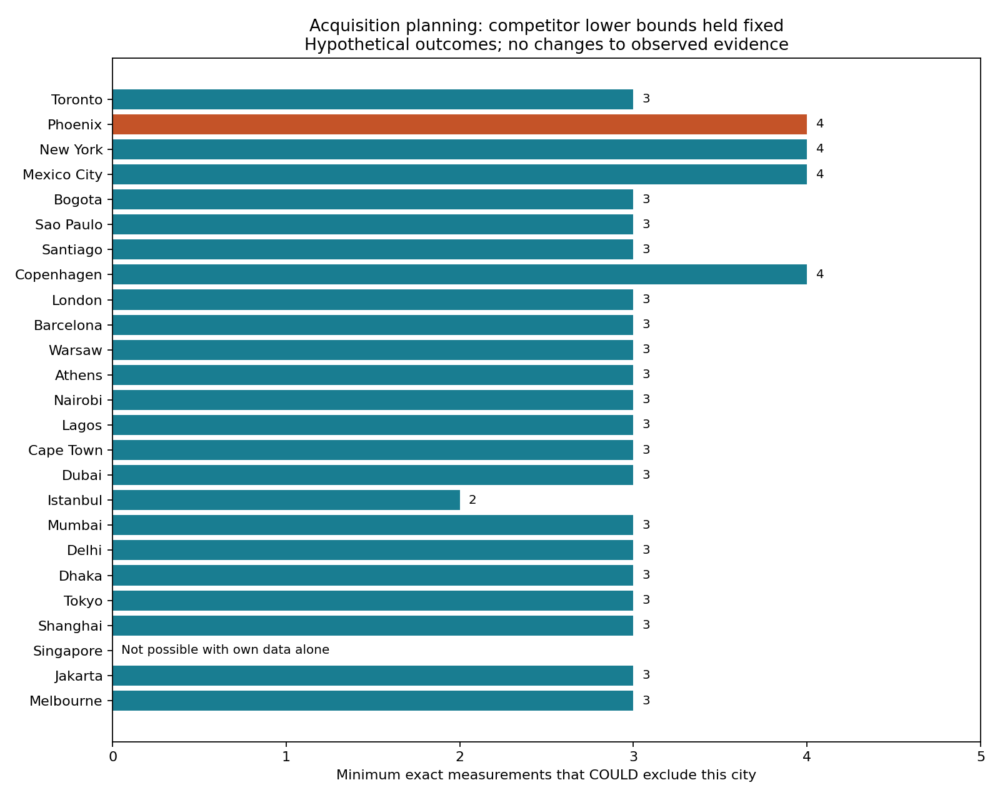

# V6：真实高中证据更新与最少补数判定

## 核心结果

V6将城市评价扩展为一个可计算的采集决策：除给出城市得分与冠军集合，还回答“至少还需测量几项指标，才可能改变某城的冠军资格”。本轮新增Istanbul、Jakarta的普通高中师生比，以及Mexico City高中阶段真实通学的保守下界；Phoenix形成逐校空间核验数据库。

同一10指标、同一权重、同一效用函数对照：

| 量 | V5实际结果 | V6实际结果 |
|---|---:|---:|
| 有信息单元 /250 | 104 | 107 |
| 平均得分区间宽度 /100 | 39.83594 | 39.23998 |
| 可能冠军数 | 25 | 25 |
| 必然冠军数 | 0 | 0 |
| 稳健选择 | Singapore | Singapore |
| 最小最坏遗憾 /100 | 35.96038 | 35.96038 |

**本轮没有缩小可能冠军集合。** 计算给出了原因和下一步采集门槛：固定其他城市的下界时，Phoenix至少需4项精确观测才可能被排除；Istanbul新增师生比后，门槛从3项降至2项，Jakarta从4项降至3项。这里的“可能”取决于实际观测结果；它是对采集数量的必要条件，不是采集成功率。

## 实测数据带来的变化

| 城市 | 新证据 | 决策序V5→V6 | 得分区间宽度V5→V6 |
|---|---|---:|---:|
| Istanbul | 408,480学生 /28,436教师＝14.36489 | 21→14 | 39.71356→32.40540 |
| Jakarta | 190,143学生 /12,114教师＝15.69614 | 24→18 | 47.28944→39.75726 |
| Mexico City | 高中阶段真实通学效用下界0.01821579 | 22→23 | 48.34367→48.28492 |
| Phoenix | 64所学校完整FTE子群记录，单列诊断 | 8→8 | 59.19188→59.19188 |

决策序按最坏遗憾排序。Mexico City自身区间收紧而相对序号下降，是其他城市证据同时更新的结果。所有城市的表现名次界仍为1–25。决策排序Kendall τ=0.91333。

Istanbul取2025/26普通高中公私学校，使用同表扣除开放教育学生后与教师人数配对。[土耳其教育部原始统计，表2.11](https://sgb.meb.gov.tr/istatistik_2026/2526.pdf)

Jakarta取2024/25全DKI六行政单元的SMA公私学校，教师人数含校长。[BPS Jakarta统计年鉴2025，表4.1.7](https://jakarta.bps.go.id/id/publication/2025/02/28/30874e042a98939928603ee5/provinsi-dki-jakarta-dalam-angka-2025.html)

Phoenix使用NCES 2024–25学校位置与官方市界作空间匹配。939条州级候选中158所位于市内，最终64所同时满足纯9–12年级、非虚拟、正常运营、学生和FTE数据完整且分年级人数匹配。50,621学生、2,480.97教师FTE，子群比值20.40371；该子群跨37个LEA。逐校审计保留了混合学段、缺失及虚拟学校。该记录用于公共高中学校层面的分析；全市headcount指标与真实学生通学仍保留[0,1]。[NCES官方学校服务](https://services1.arcgis.com/Ua5sjt3LWTPigjyD/arcgis/rest/services/School_Characteristics_Current/FeatureServer/1)

本轮两个教育点值都属于普通高中范围，继续沿用V5的条件口径分析。Jakarta由官方web表人工转录；Mexico City由官方PDF搜索索引转录，未取得可归档原PDF。36组敏感性比较分别使用全部新增条件证据、只使用新增完整归档证据、只增加教育证据及V5基线，配合3档锚点和3档辅助权重；全部保持Singapore为稳健选择、25城为可能冠军。`new_archived_only`筛选本轮新增来源，V5既有证据条件保持不变。

## 当前数学模型

### 1. 可解释效用与固定权重

对原值x及固定锚点a，成本项与收益项分别为：

$$u^-(x)=\frac{a}{a+x},\qquad u^+(x)=\frac{x}{a+x}.$$

通学采用分钟单位的学生效用：

$$T_i=\mathbb E[\exp(-t/30)].$$

8项主指标权重各0.1125，公交和泳池各0.05。未知格为[0,1]；部分资源清单给[u(x),1]。数据更新只收紧有来源支持的格，权重不随城市缺失情况变化。既有纽约、新加坡、Melbourne的真实通学区间保持原样。

### 2. Mexico City：缺失人数与图表对应关系共同进入边界

官方图49给出2015年CDMX未满18岁高中阶段EMS通学数据，来自2020年报告。程序从15个柱值中枚举3,003个五元素组合，唯一恢复出总数N=228,967的EMS组。其5个计数为39,240、79,954、77,881、29,661、2,231。[Evalúa官方报告，图49、印刷页71](https://www.evalua.cdmx.gob.mx/storage/app/media/invyest/INFANCIAS%20EN%20LA%20CIUDAD%20DE%20MEXICO%202020.pdf)

图例对应关系在当前可读索引中未确认，因此令Π包括全部120个排列。往返时间分箱上端b=(30,60,120,240,∞)，同一3–17岁义务教育母体中未报时长人数M=1,625,498−1,548,151=77,347。把M全部分配给高中群体且取零效用，可得：

$$\underline T_{MC}=\min_{\pi\in\Pi}\frac{\sum_{k=1}^{5}n_{\pi(k)}e^{-b_k/30}}{N+M}=0.0182157874,\qquad\overline T_{MC}=1.$$

推导使用单程时间t≤往返时间R，故exp(−t/30)≥exp(−R/30)；未报时长学生数量至多M，效用非负。将最大缺失质量与最不利图例排列同时纳入，可在不确定图例下仍形成有效保守界。直接按推测图例排序会得到0.08714，本轮采用的是所有排列中的最小值。以上界针对所述调查群体及发布计数，人工转录来源可在严格新增归档情景中撤回。

### 3. 区间TOPSIS与冠军集合

$$D_i^+=\sqrt{\sum_jw_j(1-u_{ij})^2},\quad D_i^-=\sqrt{\sum_jw_ju_{ij}^2},\quad S_i=100\frac{D_i^-}{D_i^++D_i^-}.$$

对各指标单调性给出L_i=S(l_i)、U_i=S(h_i)。未知量使用独立矩形集合的保守闭包：

$$\mathcal C=\{i:U_i\ge\max_{k\ne i}L_k\},\qquad
R_i=\max(0,\max_{k\ne i}U_k-L_i),\qquad i^*=\arg\min_iR_i.$$

并列最高仍属于可能冠军，因此排除必须满足严格不等号。

### 4. 新增：最少补数判定

令H_i=max_{k≠i}L_k，J_i为城市i尚未确定的指标。对拟采集集合A⊆J_i，把集合内效用置于现有下界、其他效用保留上界，记为v_i(A)：

$$v_{ij}(A)=\begin{cases}l_{ij},&j\in A,\\h_{ij},&j\notin A.\end{cases}$$

精确测量A后能达到的最低得分上界就是S(v_i(A))，所以城市本地最小采集数为：

$$m_i=\min_{A\subseteq J_i}\{|A|:S(v_i(A))<H_i\}.$$

没有可行集合时m_i=∞。程序按集合大小穷举，首次发现可行集合即得到最小值，保留该层全部并列采集方案。10项指标使每城最多1,024个子集，能够直接验证最优性。用于计算m_i的假设端点始终在独立数组中，不写回任何观测。

若只测量单项j，令q=H_i/100，排除边界可写为：

$$(1-q)^2\sum_kw_ku_k^2-q^2\sum_kw_k(1-u_k)^2<0.$$

其余效用固定在上界后，这是关于u_j的二次不等式；代码利用得分单调性求严格阈值。有限阈值处是并列，须测得低于阈值才能排除；已经排除的城市记阈值∞。

这个判定针对固定竞争者下界下的城市本地采集。若同时采集竞争城市、提高其下界，门槛会改变；多项指标之间若有已证实的联合约束，也可进一步更新可行集。它给出采集结构，不假设未知结果的概率分布。

## 下一轮的具体采集路线

- **Phoenix**：继续补真实高中生通学及完整同口径教师数据，同时扩展市级空气、凶杀或宽带证据。当前4项门槛中有15组并列最小方案，详见`minimal_bundles_after.csv`。
- **Istanbul**：高中资源证据已到位，最小两项组合为“凶杀＋高教资源”“凶杀＋通学”“高教资源＋通学”。优先查真实高中生通学，并补第二项匹配来源。
- **Mexico City**：获取原图或调查微数据，可消除图例排列不确定性；目前保留全部排列的稳健界。后续应同时更新调查年份。
- **Phoenix学校库**：已知9–12年级人数74,365，仍有4校年级人数特殊缺失码；下轮可研究有明确学生分母的学校效用加权与缺失质量界，先完成目标群体定义及分母审计。



## 实现与验证

主模型：`../../scripts/task4_v6_model.py`；新算法：`../../scripts/task4_champion_acquisition.py`。原始数据、hash、提取器、范围审计分别在`../../data/task4_v6_education/`、`task4_v6_phoenix/`、`task4_v6_commute/`。

```sh
python3 research/2026-a/data/task4_v6_education/extract_education.py
python3 research/2026-a/data/task4_v6_phoenix/extract_phoenix.py
python3 research/2026-a/data/task4_v6_commute/extract_commute.py
python3 research/2026-a/scripts/task4_v6_model.py
python3 research/2026-a/scripts/test_task4_v6.py
```

验证覆盖来源hash及加总、学校空间筛选、3,003个阶段组合、120个图例排列、V5→V6区间嵌套、真实通学保留、FTE子群拒绝、人工来源撤回、假设端点不修改数据，以及最小补数的穷举核验。独立复核还修复了字符串False/NaN可能被误作准入标记的问题，相关回归测试已加入。

完整结果：`rank_changes.csv`、`utility_bounds.csv`、`source_admission.csv`、`sensitivity.csv`、`acquisition_certificate_after.csv`；独立审核见`../task4_v6_review.md`。
