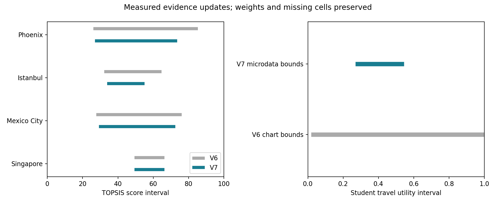

# V7：从高中生微数据到可检验的冠军排除门槛

## 本轮贡献与结果

V7取得Mexico City官方高中阶段通学微数据，直接识别单程时间、调查权重和缺失人数；同时将部分辖区风险记录转换为正确方向的效用界，并补齐Phoenix公共安全及Istanbul高教行政总量。这使模型能够提出一项可由下一次调查验证的决策条件：**若Istanbul高中生通学效用上界低于0.35219673，在当前其他证据下即可排除其冠军资格。**

| 结果 | V6 | V7 |
|---|---:|---:|
| 有信息单元 /250 | 107 | 110 |
| 更新单元 | — | 4 |
| 平均得分区间宽度 /100 | 39.23998 | 38.08314 |
| 最小最坏遗憾 /100 | 35.96038 | 28.17359 |
| 稳健选择 | Singapore | Singapore |
| 可能冠军数 | 25 | 25 |

本轮可能冠军集合保持25城；最坏遗憾减少7.78679分。12组辅助权重和来源退出情景均保持25城可能冠军及Singapore稳健选择。去掉新增人工转录来源后，微数据单独更新的最坏遗憾仍35.96038；因此遗憾改善主要来自公共安全等新增证据，不能全部归功于通学微数据。相关对照在`sensitivity.csv`。

## 真实通学的直接改进

[INEGI官方2015微数据](https://www.inegi.org.mx/contenidos/programas/intercensal/2015/microdatos/eic2015_09_csv.zip)包含553,032条CDMX个人记录。按年龄3–17岁、在学状态、已完成学段与年级重构EMS当前高中阶段，得到14,920条样本、加权238,464人，覆盖全部16行政区。5个已报告时长箱的加权人数逐项复原V6所引用的官方图表：39,240、79,954、77,881、29,661、2,231。

原问题直接询问通常住处到学校的时间，包含等车与换乘，排除途中其他活动；家庭成员可代理回答。因此它测量通常直接通学时间，属于调查报告数据。原字段的分箱为≤15、16–30、31–60、>60–120、>120分钟。8,857名未报时长者和640名不出行者都保留效用[0,1]。

| 通学量 | V6图表边界 | V7微数据边界 |
|---|---:|---:|
| Mexico City下界 | 0.01821579 | 0.26962981 |
| Mexico City上界 | 1 | 0.54489320 |
| 区间宽度 | 0.98178421 | 0.27526339 |

时间箱映射、单程定义、目标群体缺失人数三项不确定性得到直接解决。仍保留箱内位置、未报时长和不出行的未知部分。两版针对同一2015群体，因而可以验证前后嵌套；没有把不同年份当作同一次观测。结果是在调查权重与分箱计数条件下的识别界，未估计抽样设计置信区间。

## 公共安全与高校资源的口径

Phoenix年度UCR表将2024年138名谋杀及非过失杀人受害者与8例过失死亡分列。本轮使用138，配同年同市Vintage2024人口1,673,164，率为8.24784659/10万人。[Phoenix官方表](https://www.phoenix.gov/content/dam/phoenix/policesite/documents/crime-stats-and-maps/UCR2024_YTD.pdf)、[Census人口表](https://www.census.gov/newsroom/press-releases/2025/vintage-2024-popest.html)。该记录固定年度发布版本，来源为web核验后转录。

Istanbul 2025警方辖区307名谋杀死者属于全省同类事件子集；以全省人口15,754,053为固定分母，得到全省率的下界1.94870488，而非完整率。来源是AA基于警方信息的原始报道与TÜİK人口发布，地区包含关系及分类作为准入条件。[AA原报道](https://www.aa.com.tr/tr/gundem/istanbul-polisi-gecen-yil-faili-mechul-cinayet-birakmadi/3789805)

高教指标沿用V5“独立高等教育机构”的广义口径：官方2022完整行政汇总13公立大学＋43基金会大学＋4独立职业高教＝60所，配同年人口15,907,951。56所大学另作诊断，不用它替换广义高教总数。[İSTKA最终区域计划5.3.4、表5.5](https://www.istka.org.tr/media/pdf/jUnXem7E05fo5rmajTVWXZ5z6X6TXelaYMoVRPn0sIkZTwcCaJTR.pdf)

Phoenix的NHTS2022缺州/都会区标识，2017可识别的735户、1,465人是全年龄都会区；TRP2026议程有高中参与名单而无各校通学数值。相应调查范围不能生成Phoenix高中生行政市估计，故其真实通学保持[0,1]。完整审计在`../../data/task4_v7_phoenix/evidence_gaps.csv`。新增国家年份数据适合背景分析，本轮没有用全国均值填城市缺口。

## 排名与决策含义

| 城市 | 决策序V6→V7 | 得分区间V6 | 得分区间V7 |
|---|---:|---|---|
| Phoenix | 8→24 | [26.1244,85.3163] | [27.0281,73.5882] |
| Istanbul | 14→8 | [32.3066,64.7120] | [33.9734,55.0957] |
| Mexico City | 23→21 | [27.8098,76.0947] | [29.2390,72.5178] |
| Singapore | 1→1 | [49.3559,66.3110] | [49.3559,66.3110] |

决策序按最坏遗憾排序，不是已识别的真实城市表现顺序；所有城市表现名次界仍1–25。Phoenix此前最高的乐观上界被真实安全数据压低，竞争者中限制稳健选择的最高上界随之改变，解释了其自身下界改善而相对决策序下降。Kendall τ=0.85333。



## 当前数学公式

固定8项主指标各0.1125、2项辅助各0.05。成本效用u=a/(a+x)，收益效用u=x/(a+x)，学生通学T=E[exp(−t/30)]。

对真实通学分箱[a_b,b_b]及调查加权人数n_b，未知质量n_?保留[0,1]，N=Σn_b+n_?：

$$\underline T=\frac{\sum_bn_b e^{-b_b/30}}N,\qquad
\overline T=\frac{\sum_bn_b e^{-a_b/30}+n_?}N.$$

无穷上端的exp项为0。代码对分箱下端使用保守连续闭包，例如16–30分钟取[15,30]，不根据整数显示推断未声明的测量精度。

对部分辖区事件数d≤D及完整地域人口P：

$$x=10^5D/P\ge10^5d/P=x_L,\qquad u_{\rm cost}\in[0,a/(a+x_L)].$$

这与收益型部分机构名录的[u(x_L),1]方向相反。遗漏的风险记录只会降低成本效用，不能将这类记录按收益下界处理。

$$D_i^+=\sqrt{\sum_jw_j(1-u_{ij})^2},\quad D_i^-=\sqrt{\sum_jw_ju_{ij}^2},\quad S_i=100\frac{D_i^-}{D_i^++D_i^-}.$$

$$L_i=S(l_i),\ U_i=S(h_i),\quad\mathcal C=\{i:U_i\ge\max_{k\ne i}L_k\},\quad R_i=\max(0,\max_{k\ne i}U_k-L_i).$$

稳健选择i*=argmin R_i。独立矩形未知集合与固定偏好条件沿用V6。

最少补数m_i=min{|A|:S(v_i(A))<H_i}，H_i=max_{k≠i}L_k，v在拟采集项取当前下界、其他项取上界。V7中Istanbul m=1、Mexico City m=3、Phoenix m=4。Istanbul唯一单项可行采集是通学；保持其他指标当前上界时，S_i=H_i的阈值为T*=0.3521967322。因此：

$$\overline T_{Istanbul}<0.3521967322\ \Longrightarrow\ Istanbul\notin\mathcal C.$$

严格阈值来自当前数据与默认权重。均值通学时间本身不能直接证明这个效用上界；下一轮需要完整分箱、微数据，或其他足以限制E[exp(−t/30)]上界的证据。相等仍可并列冠军。

## 复现与验证

三个新增数据包和Phoenix调查审计均有来源记录及离线脚本。Mexico原始23MB ZIP流式读取，无145MB解压中间副本。人工核验记录明确区分于原始文件归档。

```sh
python3 research/2026-a/data/task4_v7_mexico/extract_mexico.py
python3 research/2026-a/data/task4_v7_istanbul/extract_istanbul.py
python3 research/2026-a/data/task4_v7_core/extract_core.py
python3 research/2026-a/data/task4_v7_phoenix/audit_sources.py
python3 research/2026-a/scripts/task4_v7_model.py
python3 research/2026-a/scripts/test_task4_v7.py
```

验证包括553,032条原始记录、官方五箱逐项复原、完整16区、缺失质量保留、效用界嵌套、部分风险上界方向、60所广义高教总量、人工来源退出、冲突拒绝及Istanbul阈值两侧核验。独立代码审核见`../task4_v7_review.md`。
