# 获奖论文图片风格蒸馏与本题制图规范

2026-11-07。将具体获奖论文的视觉做法转成用于本题的地图、模型图与分析图规范。[统一 guideline 与当前验收标准](../GUIDELINES.md)覆盖最终字号、多源地图和证据表达。

## 范围与证据等级

- 全库索引覆盖 **68篇馆藏论文、998个候选图页**；候选页不等于独立图片，可能包含表格、装饰、扫描页或多个图。
- 全部候选页已经生成可复现的多标签类别索引。类别由图题关键词匹配，部分精选参考页补充人工视觉标签。**没有声称998页均已逐图人工审美审阅。**
- 前轮通过联系表浏览50页；本指南以已有精选地图、8份重绘参考及补充检查的矩阵/残差/雷达页作为具体视觉依据。本指南收录19张来源卡，跨19个精选参考页在索引内标记。
- 评价“值得参考”是本题的设计判断，不是获奖因果，也不表示获奖论文的每张图都好。Outstanding、Finalist等奖项以原始索引为准。

[图文版](index.html) · [便携PDF](style_guide.pdf) · [全库分类检索](catalog.html) · [分类CSV](page_style_index.csv) · [分类JSON](page_style_index.json) · [方法与数量](classification_summary.json)

## 本题先采用的视觉路线

**地图优先跟13904队：浅灰真实底图、彩色数据层、清楚的局部放大。全球定位参考13719队，多指标地理面板参考16742队；框架跟14995队，统计线图跟13719队。** 不要求每张图长得一样，只要求同一种视觉编码全篇保持含义一致。

第一版的问题不是“不够花哨”，而是无地理参照的空间图、大号宣传式标题、统一卡片构图和过多图内说明。第二版改善了字体与结构；这轮真实底图必须补齐海岸、道路等地理语境，同时保持数据层可读。

## 全库分类结果（页级，多标签）

| 类别 | 候选页数 | 解释 |
|---|---:|---|
| 未分类待复核 | 727 | 无可识别类别，需人工复核 |
| 趋势与拟合 | 83 | 图题规则命中或精选参考人工补充；不是独立图片数量 |
| 排序与组间比较 | 73 | 图题规则命中或精选参考人工补充；不是独立图片数量 |
| 分布与残差 | 44 | 图题规则命中或精选参考人工补充；不是独立图片数量 |
| 机制与概念示意 | 34 | 图题规则命中或精选参考人工补充；不是独立图片数量 |
| 敏感性与不确定性 | 33 | 图题规则命中或精选参考人工补充；不是独立图片数量 |
| 流程与模型框架 | 32 | 图题规则命中或精选参考人工补充；不是独立图片数量 |
| 模拟空间与三维图 | 22 | 图题规则命中或精选参考人工补充；不是独立图片数量 |
| 矩阵与相关性 | 17 | 图题规则命中或精选参考人工补充；不是独立图片数量 |
| 地理地图 | 16 | 图题规则命中或精选参考人工补充；不是独立图片数量 |
| 构成与权重流 | 13 | 图题规则命中或精选参考人工补充；不是独立图片数量 |
| 雷达与极坐标 | 9 | 图题规则命中或精选参考人工补充；不是独立图片数量 |
| 表格代码与非图形候选 | 4 | 图题规则命中或精选参考人工补充；不是独立图片数量 |

同一页可以出现地图、折线、流程图，因此类别数量不能相加当作总图数。无图题页保留为未分类，不依据文件存在就猜测其风格。

## 地图 1｜25座城市的全球分布

参考：13719 / 2023 / PDF p.7；16738 / 2025 / PDF p.9。

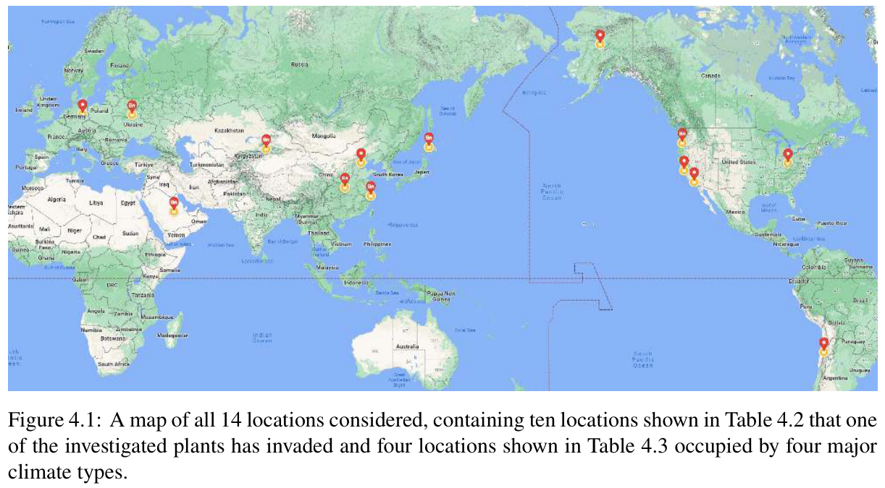

1. 目的：先交代研究对象在哪里；不把一张定位图强行做成排名、气候、收入、人口四合一。25城必须全部出现，图上名称须与候选CSV一一对应。

2. 底图：真实海岸线、陆地和国界；全球图不需要街道。选适合全球展示的投影，避免直接用经纬度散点坐标轴冒充地图。正文标注底图来源和下载版本。

3. 版面：全球主图占约三分之二至四分之三画面；欧洲、南亚、东亚点位密集时用放大窗或编号索引。放大窗框出母图范围，不能让读者以为是另一组样本。

4. 视觉：海洋用很浅的蓝灰，陆地用暖白，边界为细灰线；候选城市用一种强调色，选中的内部地图案例再用另一种点形。不要让深色地形或密集地名盖过25个点。

5. 标注：同一字体，城市名与点保持稳定距离；必要时用细引线。不要为了避让把点移到错误的地理位置。跨日界线的投影应保证东京、墨尔本等不被切开。

6. 本题图注：25座候选城市的地理分布，点表示源数据采用的城市参考坐标，不代表精确行政中心或统一都市区边界。城市候选身份不等于最终评估结果。

## 地图 2｜城市内部可达性

参考：13904 / 2023 / PDF pp.11、20–22；16742 / 2025 / PDF p.12。

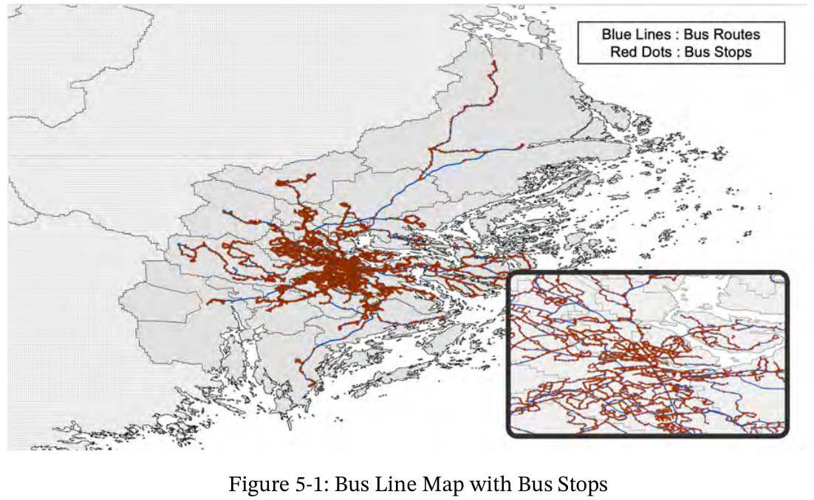

1. 目的：让读者看见城市内部“哪些位置更容易到达学习设施”，并解释平均值为什么可能遮蔽不便利地区。地图必须有地理参照，不能只展示悬空六边形轮廓。

2. 层次：底层放真实海岸、水域和主要道路；中层放可达性网格；最上层保留少量地名、比例尺、图例与指北方向。底图应淡，网格是主角，道路仍可辨认。

3. 网格：直接用归档GeoJSON几何，坐标系正确转换后再绘制。颜色编码时间或效用二选一，并明确方向。时间高=较难到达；效用高=较易到达，不能混用。

4. 空白：保留网格外区域不涂成“低可达性”；无效时间不涂成最好。未覆盖、零人口、无效数据与真实低效用要在图注或图例区分。

5. 放大窗：借鉴13904的局部放大，展示中心区道路与网格。窗口里可重新设置比例尺，但不能独立拉伸色标。主图与放大窗都要说明范围。

6. 本题限制：当前Learning字段是到邻近20个同类POI的模型时间，人口是全年龄居民。图中不写“高中生通学时间”“教育质量”或“最近高中”，也不凭空补学校位置。

## 地图 3｜同域对照与地理小多图

参考：13904 / 2023 / PDF p.21；16742 / 2025 / PDF p.12。

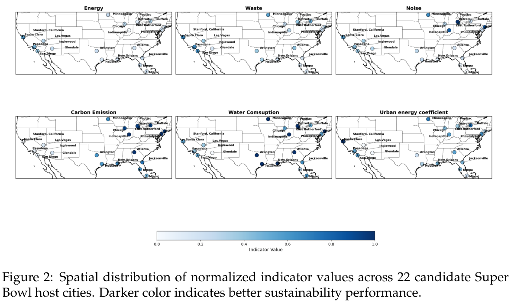

1. 同城对照：前后或两种方案必须使用同一范围、投影、底图、色标和图层顺序。不能让自动缩放制造“改善很大”的印象。

2. 跨城对照：若地图范围不同，每幅独立标比例尺并在图注直说。城市面积差异很大时，可提供统一物理尺度的局部图作为补充，而不是只统一画框大小。

3. 面板：两到四幅大地图通常比六幅小邮票更易读；统一左上角(a)(b)(c)和城市名。共用色标放在整组下方，不为每幅重复占位。

4. 色标：时间建议有明确单位和阈值的连续或分级色标；效用固定0–1。分级阈值属于分析选择，应在说明中记录。

5. 不要误用：这类专题地图属于地图，即使颜色表达数值；相关矩阵不是地图。模型散点若没有真实地理定位，也不能写成实际城市底图。

## 框架｜四分区模型总览

参考：14995 / 2024 / PDF p.4，Figure 1。

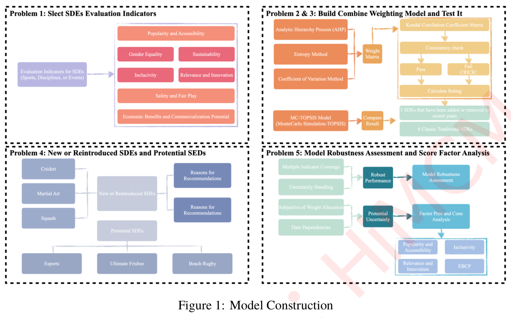

1. 学的是结构：按任务划分四个区域，每区一种功能色，内部按输入→处理→输出连接。不是把整篇摘要拆成六个一样的大框。

2. 本题四区：候选城市与代理指标；基准评价；网格可达性与低尾；修订检验及未知教育证据。两个实验应分开画，不用一条箭头混成同一个结论。

3. 框中文字：每个节点只表达一个操作或结果，约一至两行；公式保留能解释机制的核心关系，不写段落。

4. 线与边框：分区外框可用0.6–0.8pt细虚线，内部实线0.5–0.7pt。箭头贴近被连接的框，避免线压字、无起点和装饰性循环。

5. 颜色：珊瑚、浅金、淡紫、薄荷按任务分工，填色轻、文字深。不要在同一框里叠渐变、阴影、图标和高光。

## 机制｜把模型对象画出来

参考：14632 / 2023 / PDF p.8，Figure 4。

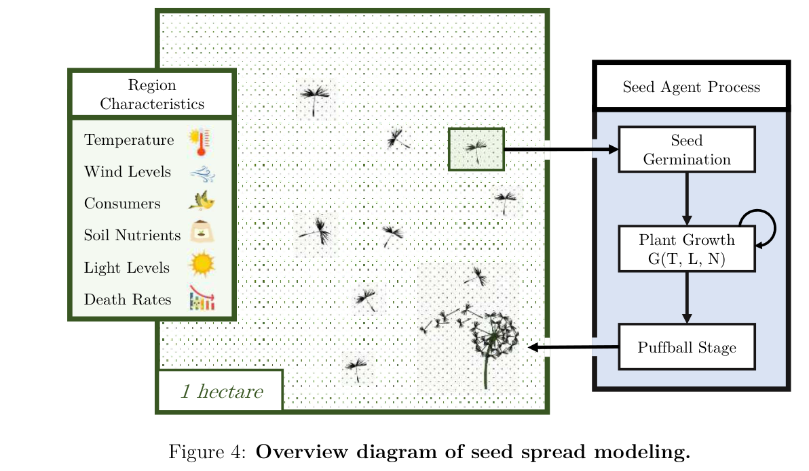

1. 参考图的可取之处是把环境输入、空间对象与演化过程放在同一图中，使读者能看到变量作用在哪里。蒲公英插画不属于本题，不照搬。

2. 本题可以画居民网格→时间t→效用exp(-t/30)→人口加权均值与最差20%→综合Q。若放地图小窗，它应来自真实城市数据。

3. 机制图可含示意格子，但须标“示意”；示意不能与实测地图拼接后不给边界。所有数字例子须说明是推导、假设或实证。

4. 优先用形状承担解释：一个网格代表一个空间单元、箭头表示计算方向、括号表示聚合；不要放没有解释意义的电脑、云朵、城市天际线。

## 比较｜排名、分组与构成

参考：13719 / 2023 / PDF p.22；15504 / 2024 / PDF p.18；16739 / 2025 / PDF p.9。

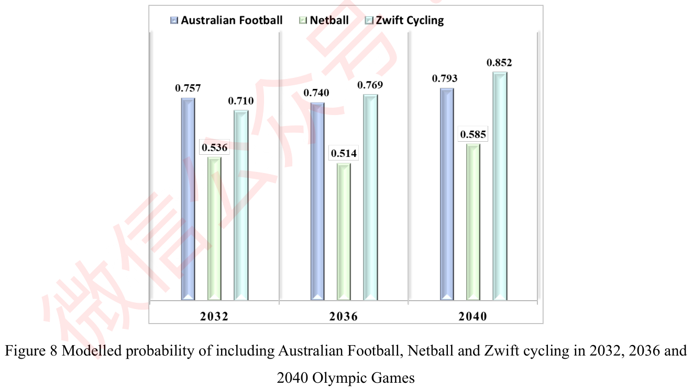

1. 城市名较长时使用横向条或点图；完整25城的排名应完整呈现，重点城市用颜色或注释强调，不因美观任意删除。

2. 柱状图从零开始。条尾直接标数值时保留合理精度，通常一位或两位小数；避免用3D高光改变长度感知。

3. 分组柱的组内顺序固定，颜色只表示同一个统计量。跨图同一颜色若代表城市，其他面板不要又用它表示均值。

4. 不同单位的代理指标不能随意堆叠。百分比构成需有共同分母；Sankey宽度必须对应可相加的数量或权重，不能凭视觉随意画粗细。

5. 排名变动最好同时保留基准、只加均值、再加低尾三个阶段；图注说明模型发生变化，不宣称城市现实变好。

## 曲线｜趋势、拟合与敏感性

参考：13719 / 2023 / PDF p.16；14632 / 2023 / PDF p.8。

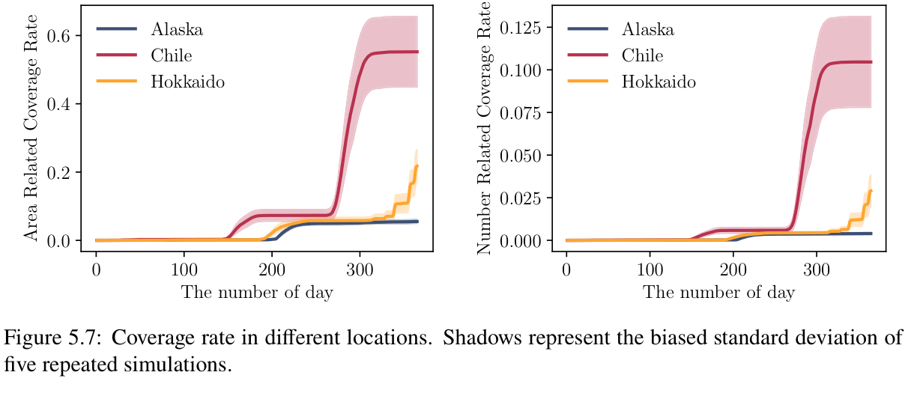

1. 借鉴细轴框、Times字形、藏蓝/玫红/金黄三条清楚的线。给每条线额外的点形或线型，灰度打印仍能辨认。

2. 时间序列、经验拟合和解析函数要分清：原始点用散点，拟合用线，模型假设的参数扫描明确称“敏感性”。不能把人为参数曲线写成观测趋势。

3. 阴影带必须有数学定义：置信区间、标准差范围或情景边界。当前没有重复实验误差时，不为好看仿画原图误差带。

4. 同组面板尽量共享单位和刻度；只保留轻网格或不用网格。每幅小图短标题说明变量，整张图的解释放图注。

5. 本题低尾权重λ变化是规范性选择，不是时间变化；固定其他输入后画Q(λ)，图中标主情景λ=0.3。

## 分布｜箱线、残差与累积分布

参考：16739 / 2025 / PDF p.9；13719 / 2023 / PDF p.16。

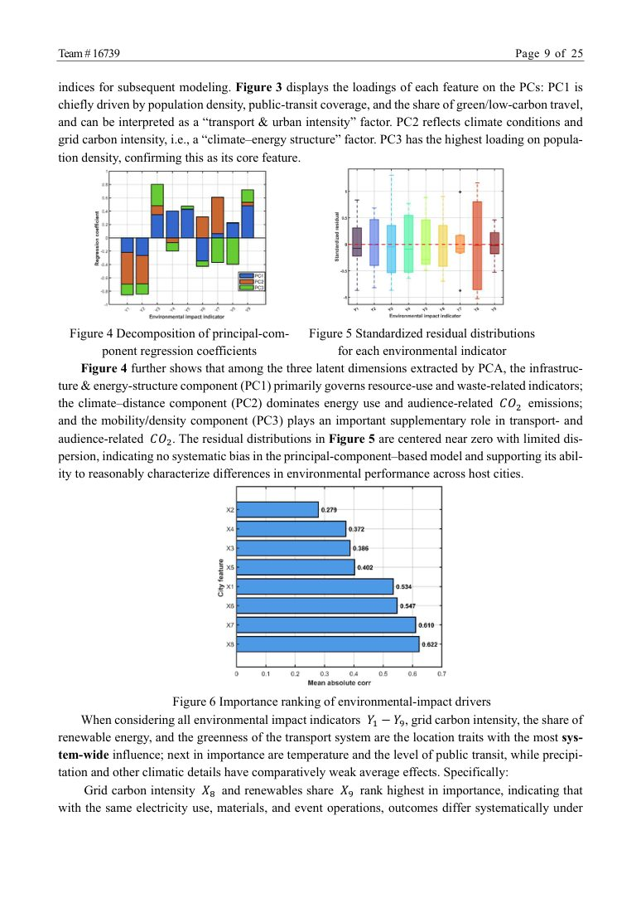

1. 箱线和直方图需要一组观测或明确的模型抽样；每城只有一个总分时，不得制造箱体。须与异常点规则必须说明。

2. 居民网格的时间或效用可画人口加权累积分布，比只画平均值更能呈现内部差异。注明分母是保留人口，不是学生样本数。

3. 各城分布比较使用同一横轴范围和同一权重规则。若时间长尾很长，截轴或对数轴要明确写出，不能默默裁掉。

4. 最低20%人口的聚合应按人口质量而不是网格个数计算，分位边界可使用部分权重。地图面积分布不等于人口分布。

## 矩阵｜相关性与指标画像

参考：16739 / 2025 / PDF p.8，Figures 1–3。

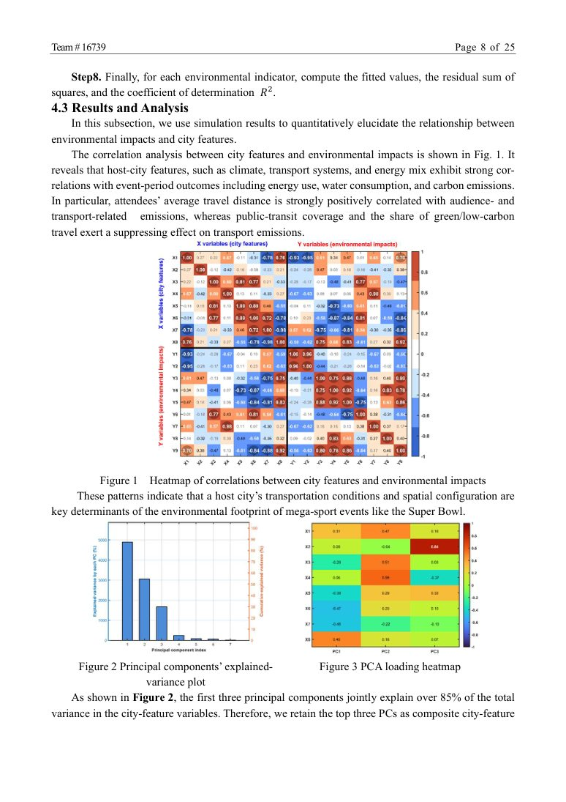

1. 相关系数用以0为中心的双色标，范围固定[-1,1]；0–1收益方向分数用单向色标。不能用同一色谱暗示它们数学含义一样。

2. 行列标签、排序规则和色标三者齐全。25城×5项可横排为5行，放横向附录；正文缩小后文字小于9pt时应拆成分组图。

3. 单元格数字要克制精度，深色格用浅字、浅色格用深字，网格线细白即可。缺失值用独立灰色或符号，不涂成零。

4. 相关性用于诊断重复信息或结构，不是因果证据。不要只因获奖论文用了PCA热图就给本题增加无作用的PCA图。

## 不确定性｜界限、区间与可行集合

参考：13719 / 2023 / PDF p.16（视觉参照）；本题归档可行区间分析。

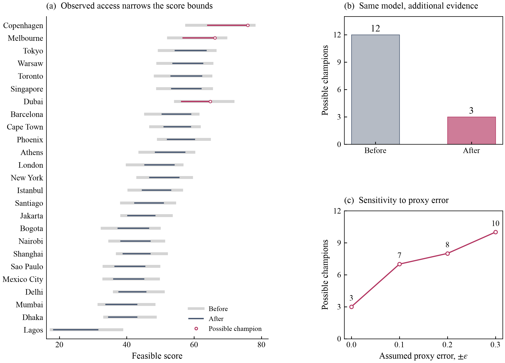

1. 本题使用“可行分数区间”：未知指标在允许范围内变化得到的边界，不是统计置信区间，也不是城市胜率。样式可借鉴细线区间，措辞必须忠于计算。

2. 同一城市补证据前后的区间可粗灰底线＋细深色线叠放；前后模型和权重相同才能把区间收缩归因于信息增加。

3. 可能冠军用空心点或额外符号标注，不能仅依赖红绿配色。明确“可能”不是“必然”，当前教育质量仍未知。

4. 代理误差的横轴写“假设误差宽度”，不要写“实测标准误”。在允许误差扩大时可能冠军集合如何变化，可单独用小面板说明。

## 多面板｜用排列建立证据链

参考：13719 / 2023 / PDF pp.15–16、22；16742 / 2025 / PDF p.12。

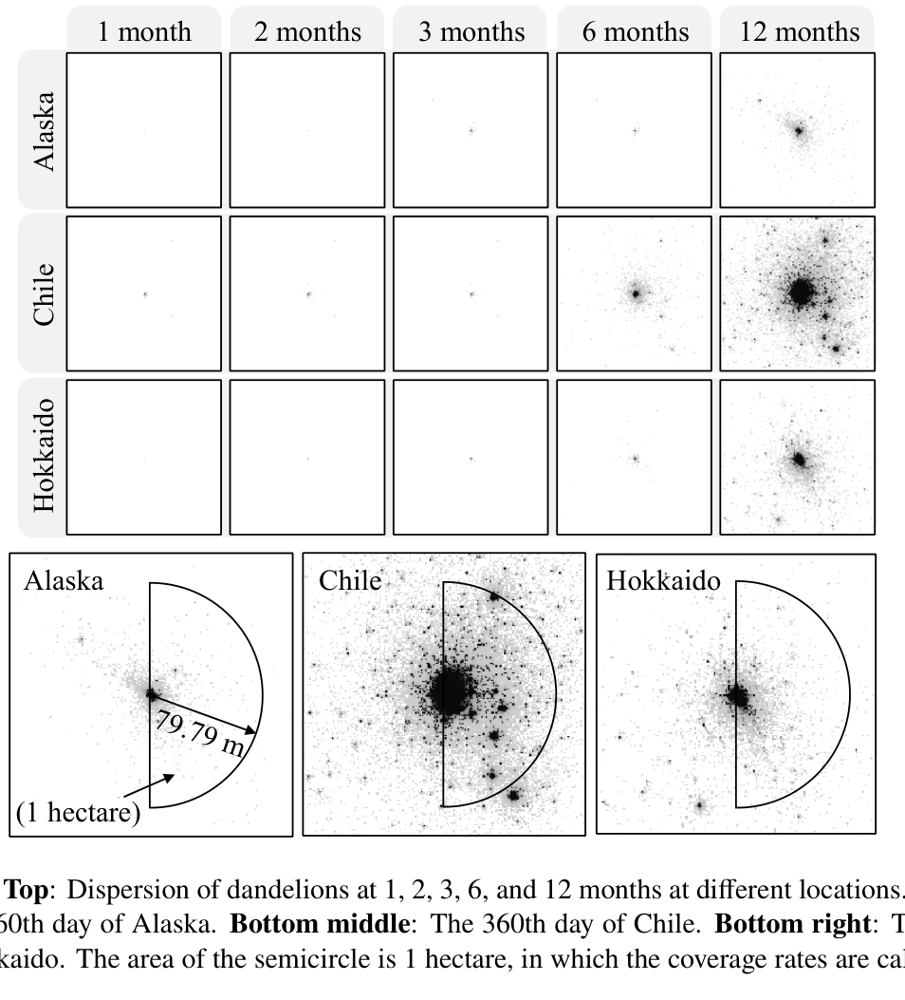

1. 每个面板承担一个问题：地图显示哪里，分布显示多少人口，机制曲线显示为什么。避免把互不相关的漂亮图拼成一页。

2. 先确定最终印刷宽度，再决定2、3还是4个面板。城市地图通常2–3幅；25城排名一幅完整长图；五指标矩阵适合横向页面。

3. 同类面板边框、标题位置、标签间距一致。只共用真正可比的色标和坐标；不同尺度面板必须在图注说明。

4. 地图缩略图与局部放大图用框和引线标关系；局部图不应覆盖最关键的主图区域。不同城市放大区的选择要有解释。

## 备选｜雷达、极坐标与三维

参考：16738 / 2025 / PDF p.20；13719 / 2023 / PDF p.16。

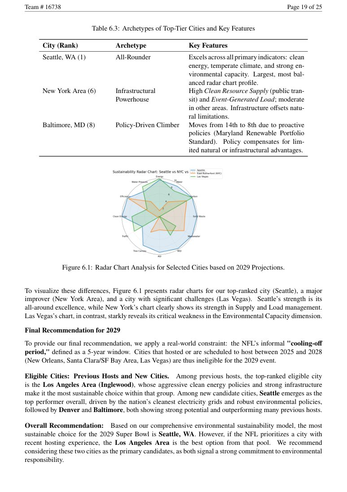

1. 雷达图只适合少数城市的同尺度多指标画像；轴顺序改变面积，重叠多时读不清，不能用多边形面积直接排名。25城全部放一张雷达图不采用。

2. 极坐标只有角度真有意义时采用，例如方向性风、出行方向；仅为造型把城市排成圆环会增加阅读成本。

3. 三维图只有第三维承载必要量时采用；表面遮挡、透视与颜色须可解释。二维位置＋颜色已经够用时不加3D。

4. 原图图片、插画、代码截图、表格截图在图库中可能被检测为图页。它们不能自动算作已确认的科学图形，也不能从获奖身份推断质量。

## 统一制作参数：这是本队建议，不是从原图精确测得

| 元素 | 建议值／做法 |
|---|---|
| 字体 | 英文Times New Roman或与正文字体协调的衬线体；同一图不混用多套英文字体 |
| 最终字号 | 图例、说明、刻度和署名至少9pt；主标签10–11pt；面板标题11–12pt；按插入论文后的尺寸检查 |
| 线宽 | 坐标与行政边界0.4–0.7pt；关键曲线1.0–1.4pt；地图道路层随级别细分，不能全用粗线 |
| 分析线色 | 藏蓝 #46566F、玫红 #B33561、金黄 #E9A33B；同时用点形或线型区分 |
| 底图 | 水域浅蓝灰、陆地暖白、边界淡灰；道路清晰但不抢过数据层 |
| 顺序色标 | 一项连续量由浅到深；跨地图固定范围；不要给高低值随机彩虹色 |
| 文件 | 矢量PDF为论文主文件、SVG供编辑、300dpi PNG供预览；地图底图若为栅格应按最终印刷尺寸保证分辨率 |
| 文件命名 | 名称说明内容和版本；不要用final_final。源数据、脚本、图注与输出放在相邻目录 |

## 地图出图前的八项检查

1. 城市参考点与25城原始名单一一对应，未混入10城试点或别名重复。
2. 原始坐标、底图和叠加图层的坐标参考系正确；比例尺单位和长度合理。
3. 底图来源、数据来源、许可署名完整；署名不能被裁切或被放大窗遮住。
4. 网格颜色的范围、单位、好坏方向一致；缺失值不冒充零值或最好值。
5. 主要道路、海岸、水域仍可读；底图地名不与城市标签或数据层打架。
6. 局部放大区在主图上有定位；跨城显示范围不同已明确说明。
7. 原始CSV和ZIP不覆盖，输出能从脚本和来源记录复现；保留文件哈希与下载日期。
8. 以论文实际尺寸查看，而不是只在全屏看；地图、图例和署名缩小后仍可辨认。

## 图注模板

全球图：**Geographical distribution of the 25 candidate cities.** Points indicate the reference locations used for matching city-level records. Basemap: [provider and dataset/version].

内部地图：**Modelled walking accessibility to learning facilities in [city].** Grid colour represents [time in minutes / dimensionless utility]; values are derived from the archived source model and retained all-age population. Blank or uncoloured areas [define explicitly]. Basemap: [provider]; accessibility data: [source snapshot].

同域对照：**Spatial comparison under [two settings].** Both panels use the same extent, projection, basemap and colour scale. [Explain what changes and what remains fixed.] Differences show modelled accessibility under the stated settings.

## 数据与知识边界

地图的好看不能替代证据。当前学习可达性来自研究作者发布的空间模型，源人口并非14–18岁，设施类别并非已识别高中。源网格覆盖范围也不等于统一行政边界。不能把没有学生调查、学位和质量数据的地图改写为“最适合高中生上学的区域”。

原获奖论文地图可能引用地图平台或第三方底图；本指南只保留原图出处用于研究参考，不把它当作本题可自由复用的底图。正式重绘应使用独立取得并正确署名的真实地理资料。地图图层与许可由实际绘图版本的来源记录负责。

## 索引生成方式与维护

`build_guide.py`只读既有获奖图页索引和选图来源，输出分类CSV/JSON、图文指南与PDF。自动分类是图题关键词检索，不是视觉模型评分；可能误判、漏判或把正文提及词误当图型。未分类页保留，不能从类别数量推断论文质量。

新增人工检查后，在脚本的`manual`页级标签中补充队号与PDF页码，并在来源卡记录选择理由。PDF页码可能与正文印刷页码不同，统一用PDF页码定位。检查脚本同时验证998行无重复丢失、参考图存在、源PDF存在及HTML相对链接有效。

## 本轮真实底图地图的对应规范

本轮地图工作目录为 `../cartography/`。全球定位点读取已有 `city_index.json`，是作者都市区域的参考定位点，不是独立核验的市政中心；与25城候选表逐项匹配。

底图使用 **OpenStreetMap公开矢量道路／河流 + Natural Earth海岸线、湖泊与世界底图**。曾尝试的CARTO请求虽然返回HTTP 200，但图像实际是“API KEY REQUIRED”占位内容，已被拒绝作为底图。下载成功不等于数据可用：每种底图必须视觉检查。

对应文件名称：`01_global_candidates`、`02_copenhagen_access`、`03_toronto_access`、`04_dubai_access`、`05_shanghai_access`、`06_city_access_comparison`。最终输出与来源以cartography目录的交付清单为准。

内部图的颜色表达 **c_f：到邻近20个Learning类POI的平均模型步行分钟**，使用共同时间分级；不是最近高中距离，不是实测通学。主图保留原网格范围，中心区放大窗显示道路和网格细节。OpenStreetMap底图道路仅作真实地理参照，本轮没有重新沿这些道路计算可达性。底图获取时间与可达性源模型时间可能不同，应保留各自来源记录。

[查看25城匹配坐标](../cartography/candidate_city_locations.csv) · [查看地图范围](../cartography/map_viewports.json)
